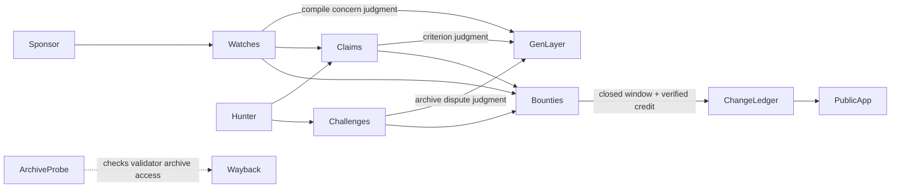

# Fine Print

Public app: https://fine-print-ten.vercel.app/ · Source: https://github.com/JWattjr/fine-print

Execution status: the requested scripted runs and current-watch funding are complete. Actual results and receipts are in [docs/RESULTS.md](docs/RESULTS.md). The cosmetic case exposes a compiler false positive, so the app is not described as submission ready.

The scripted baseline-passage case finalized CODE_REJECTED with no model judgment or claim bond. The cosmetic timing recovery finalized TRIGGERED unexpectedly: its two permission criteria were NOT_TRIGGERED, but the compiler added an absence criterion that triggered on the date-only passage. This is a recorded false positive and a product limitation. The deployed contracts and prompts have not been edited or redeployed. See [the resumable runner](docs/RUNNER.md) for account handling, fixed IDs, request budgets, the shared 1,110-wei cap and receipt recovery.

Fine Print is an archive-backed policy change bounty desk. A sponsor freezes a specific concern against a Wayback baseline. Hunters submit a later archived passage. GenLayer validators judge whether the passage meets the frozen checks, while deterministic contract code controls funding, bonds, deadlines, refunds and payouts.

The public app reads its displayed receipts from [`deploy/proof.json`](deploy/proof.json). It does not present a candidate case as a finalized catch. Each production receipt needs a finalized StudioNet transaction, contract state readback, a closed challenge window and verified native credit. Historical replays and current watches are stored separately.

## Network and pinned tools

- StudioNet, chain ID `61999`
- RPC: `https://studio.genlayer.com/api`
- Explorer: `https://explorer-studio.genlayer.com`
- `genlayer-js` `1.1.8`
- `genlayer-py` `0.18.0`
- Pinned runner: `py-genlayer:1jb45aa8ynh2a9c9xn3b7qqh8sm5q93hwfp7jqmwsfhh8jpz09h6`
- Evidence: exact successful Wayback CDX rows and immutable `id_` snapshots only

The deployment journal stores transaction hashes before polling. A pending or accepted result remains pending in the interface. The app reads state again after finality before displaying a durable result. The transaction level value ledger is checked against the owner's stricter cumulative cap of 1,110 wei.

## Architecture



The five application contracts have separate jobs: Watches freezes criteria and baselines; Claims validates later evidence and records per-criterion judgments; Challenges resolves bounded archive disputes; Bounties owns all native value and deadlines; ChangeLedger appends only finalized, settled records. Six initial captures passed ArchiveProbe before main authoring. Source inspection then identified two additional captures for the actual Zoom grant and Adobe revision; both passed ArchiveProbe before the main contracts were deployed. See [source selection](docs/SOURCE_SELECTION.md).

## Local setup

Use Node.js 20.9 or newer and Python 3.11 or newer. Install the Python packages in `requirements.txt`, then install the locked JavaScript dependencies and start the app:

```powershell
python -m pip install -r requirements.txt
npm ci
npm run dev
```

Open `http://localhost:3120`. The desk, ledger, watch docket, hunter index and case pages are readable without a wallet. Interactive actions use an injected StudioNet wallet. The dedicated runner signs its own fixed-plan transactions using a gitignored local key; the owner signed one separate funding transfer. Bounty and bond deposits remain separate writes within the shared cap.

## Checks

```powershell
npm run typecheck
npm run lint
npm test
npm run test:contract
npm run build
npm run verify:proof
npm run release
```

`verify:proof` is a read-only release gate. It checks the pinned network and runner, the required deployed addresses, canonical StudioNet Explorer address and transaction pages, finalized transaction receipts, the one-time historical case IDs and outcomes, the 3–4 open production watches, Portal contract evidence entries and the value transfer cap. It returns an error for missing or inconsistent evidence and retained readiness blockers. `release` runs that proof gate, the code checks and the production build. It never creates or edits a Portal submission.

Final evidence audit: all six contract links and 148 transaction links verified. The corrected complete state recheck passed with 72 RPC requests, 66 distinct state reads and zero errors. The readiness gate remains failed for the retained Zoom timing failure and cosmetic compiler false positive. See [the verification record](docs/VERIFICATION.md) and [its JSON report](docs/VERIFICATION.json).

## Release sequence

1. Verify Wayback CDX rows and immutable snapshots with ArchiveProbe on StudioNet, including both snapshots for Zoom, X and Adobe.
2. Deploy Watches, Claims, Challenges, Bounties and ChangeLedger with the pinned runner. Save each transaction hash immediately and wait for finality.
3. Replay each requested historical case once. Read the contract state after each transaction; retain the actual validator verdict, challenge ruling and settlement result.
4. Create 3–4 funded production watches with explicit expiry. Record every incoming contract deposit and keep the cumulative total at or below the owner's 1,110-wei cap.
5. Run the proof verifier. Open every emitted Explorer contract link and confirm the address and StudioNet contract record.
6. Deploy the app and publish the source repository. Prepare Portal fields and separate Explorer Contract evidence entries for review; do not submit them automatically.

See [`docs/TUTORIAL.md`](docs/TUTORIAL.md) for the user walkthrough and [`docs/DEMO.md`](docs/DEMO.md) for the short presentation sequence.

<!-- BEGIN ACTUAL RESULTS -->

## Actual results

| Case | Actual finalized result | Evidence |
| --- | --- | --- |
| x-ai-training | TRIGGERED · 100 wei paid | [Finalized receipt](https://explorer-studio.genlayer.com/tx/0x253fee4fc990efd38d2290203ace981ebadc956d06db36de55c06a9d3a8c275e) |
| concern-rejected | REJECTED | [Finalized receipt](https://explorer-studio.genlayer.com/tx/0x1ede355bae8d9e320279f6e9e087b6d894564425d7beee09b6a3a896435c864b) |
| adobe-content-access | VOID | [Finalized receipt](https://explorer-studio.genlayer.com/tx/0xbb6b3990e9f27624f31c68280fc6362784c0cc16c34921b40ab0b1d8d60817f8) |
| baseline-passage-rejected | CODE_REJECTED | [Finalized receipt](https://explorer-studio.genlayer.com/tx/0xfc56d44d1ff527f1849498fabd3dddb292fa40664c1f809a14da5a00596c8172) |
| cosmetic-date-only-timing-recovery · re-run after a timing failure | TRIGGERED · 10 wei paid | [Finalized receipt](https://explorer-studio.genlayer.com/tx/0x06d23da7abc6fa10979fc5610c5373247575d727889d08f055fbd8f0b2ae2a8a) |
| injection-ignored | TRIGGERED · challenge REJECTED · 10 wei paid | [Finalized receipt](https://explorer-studio.genlayer.com/tx/0x726dd642d4fcceba512b5ec3dd87b84be2292638876bb4bf5e001e9a2b61247e) |
| challenge-upheld-timing-recovery · re-run after a timing failure | VOID · challenge UPHELD | [Finalized receipt](https://explorer-studio.genlayer.com/tx/0xa1f51ff6be8968e04fe955adf6e30e1cbb934db441bd3c80f71ff486a2605a69) |
| challenge-rejected-timing-recovery · re-run after a timing failure | TRIGGERED · challenge REJECTED · 10 wei paid | [Finalized receipt](https://explorer-studio.genlayer.com/tx/0x9ef569b90b193f2f067432e031026d1c03691eb6660c88f2b67bae6b47bda356) |
| zoom-ai-training | VOID | [Finalized receipt](https://explorer-studio.genlayer.com/tx/0x4730a747fe3e378e9725eee251b607b80aeb4246fd017d0324f4cb6bf7cabeb0) |
| cosmetic-date-only | VOID | [Finalized receipt](https://explorer-studio.genlayer.com/tx/0xc4662e470cfe3ef25c332e2340a853a9c59af59fcf04384eeef3d4ad6121f2be) |
| challenge-upheld | VOID | [Finalized receipt](https://explorer-studio.genlayer.com/tx/0x6e894800defe61cac6beb17311cf4b08ce4fa273251115c9aa8fbcd2f4886fc7) |
| challenge-rejected | VOID | [Finalized receipt](https://explorer-studio.genlayer.com/tx/0x3c74ce1f89110cbfc3d4460ad18726bad89a17caa34c144f0b0704b67aa8ec12) |

**Contract deposits: 848 / 1,110 wei.** Current funded watches: 3. Direct contract evidence and watch expiry dates are listed in [the complete results](docs/RESULTS.md).

<!-- END ACTUAL RESULTS -->
