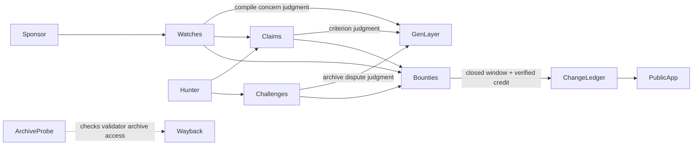

# Fine Print

Public app: https://fine-print-ten.vercel.app/ · Source: https://github.com/JWattjr/fine-print

Launch status (14 November 2026): incomplete. X's historical AI-training claim finalized TRIGGERED, cleared its challenge window and received a verified 100-wei native bounty. The subjective concern was rejected. Adobe's claim timed out and was voided; Zoom's initial escrow became refundable after ticket expiry. Remaining replay outcomes and funded production watches are still required before submission readiness.

Fine Print is an archive-backed policy change bounty desk. A sponsor freezes a specific concern against a Wayback baseline. Hunters submit a later archived passage. GenLayer validators judge whether the passage meets the frozen checks, while deterministic contract code controls funding, bonds, deadlines, refunds and payouts.

The public app reads its displayed receipts from [`deploy/proof.json`](deploy/proof.json). It does not present a candidate case as a finalized catch. Each production receipt needs a finalized StudioNet transaction, contract state readback, a closed challenge window and verified native credit. Historical replays and current watches are stored separately.

## Network and pinned tools

- StudioNet, chain ID `61999`
- RPC: `https://studio.genlayer.com/api`
- Explorer: `https://explorer-studio.genlayer.com`
- `genlayer-js` `1.1.8`
- `genlayer-py` `0.18.0`
- Pinned runner: `py-genlayer:1jb45aa8ynh2a9c9xn3b7qqh8sm5q93hwfp7jqmwsfhh8jpz09h6`
- Evidence: exact successful Wayback CDX rows and immutable `id_` snapshots only

The deployment journal stores transaction hashes before polling. A pending or accepted result remains pending in the interface. The app reads state again after finality before displaying a durable result. The transaction level value ledger is checked against the 0.1 GEN project cap.

## Architecture



The five application contracts have separate jobs: Watches freezes criteria and baselines; Claims validates later evidence and records per-criterion judgments; Challenges resolves bounded archive disputes; Bounties owns all native value and deadlines; ChangeLedger appends only finalized, settled records. Six initial captures passed ArchiveProbe before main authoring. Source inspection then identified two additional captures for the actual Zoom grant and Adobe revision; both passed ArchiveProbe before the main contracts were deployed. See [source selection](docs/SOURCE_SELECTION.md).

## Local setup

Use Node.js 20.9 or newer and Python 3.11 or newer. Install the Python packages in `requirements.txt`, then install the locked JavaScript dependencies and start the app:

```powershell
python -m pip install -r requirements.txt
npm ci
npm run dev
```

Open `http://localhost:3120`. The desk, ledger, watch docket, hunter index and case pages are readable without a wallet. Wallet actions use an injected browser wallet configured for StudioNet. The first archive probe and its six source checks send zero GEN; each write is submitted only after the wallet asks for the user’s signature. Bounty and bond deposits are separate writes and must stay within the cap.

## Checks

```powershell
npm run typecheck
npm run lint
npm test
npm run test:contract
npm run build
npm run verify:proof
npm run release
```

`verify:proof` is a read-only release gate. It checks the pinned network and runner, the required deployed addresses, canonical StudioNet Explorer address and transaction pages, finalized transaction receipts, the one-time historical case IDs and outcomes, the 3–4 open production watches, Portal contract evidence entries and the value transfer cap. It returns an error while any required proof is missing. `release` runs that proof gate, the code checks and the production build. It never creates or edits a Portal submission.

## Release sequence

1. Verify Wayback CDX rows and immutable snapshots with ArchiveProbe on StudioNet, including both snapshots for Zoom, X and Adobe.
2. Deploy Watches, Claims, Challenges, Bounties and ChangeLedger with the pinned runner. Save each transaction hash immediately and wait for finality.
3. Replay each requested historical case once. Read the contract state after each transaction; retain the actual validator verdict, challenge ruling and settlement result.
4. Create 3–4 funded production watches with explicit expiry. Record every native value transfer and keep the total at or below 0.1 GEN.
5. Run the proof verifier. Open every emitted Explorer contract link and confirm the address and StudioNet contract record.
6. Deploy the app and publish the source repository. Prepare Portal fields and separate Explorer Contract evidence entries for review; do not submit them automatically.

See [`docs/TUTORIAL.md`](docs/TUTORIAL.md) for the user walkthrough and [`docs/DEMO.md`](docs/DEMO.md) for the short presentation sequence.
